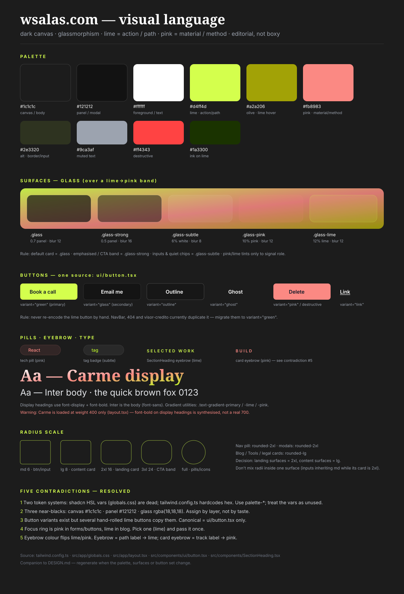

# DESIGN.md

A live, reproducible memory of the visual language of **wsalas.com**: the palette,
the type, the surfaces, the motion, and the reasoning behind each choice.

This is not a spec that the code follows. It is a description of what the code
**currently does**, plus a ruling on every place where the code disagrees with
itself. When you change a token, a surface or a button, update this file in the
same change — a design memory that drifts is worse than none.

---

## 0. The vibe

A dark, terminal-noir portfolio with a glassy, editorial feel.

- **Dark canvas, always.** There is no light mode. The background is a near-black
  canvas with a subtle animated terminal (`FaultyTerminal`, tinted lime, brightness
  0.18) fixed behind the content, and lime "sparks" on click (`ClickSpark`).
- **One accent per job.** Lime is **action and path** (primary buttons, section
  eyebrows, hover, focus, stats). Pink is **material and method** (technologies,
  the "method" apparatus, project titles, contact info). This rule is stated in
  `src/components/blog/BlogPost.tsx:23` and is the closest thing to a constitution
  the design has.
- **Editorial, not boxy.** Work and experience are lists/rows and timelines, not
  grids of equal cards. Big display headings, generous whitespace, glass panels
  that reveal the terminal behind them.
- **Motion is CSS-first.** Entrances are the `.rise` / `.pop` utilities so the
  server HTML ships visible (protects LCP); `framer-motion` is used only where a
  layout morph is genuinely needed (the project modal).

## 1. Source of truth (files)

| Concern | File |
| --- | --- |
| Color tokens, radius, fonts, keyframes | `tailwind.config.ts` |
| CSS utilities (`glass*`, `glow*`, `.rise`, gradients), base `body` | `src/app/globals.css` |
| Font loading (Inter + Carme) | `src/app/layout.tsx:20` |
| Button variants | `src/components/ui/button.tsx` |
| Section eyebrow + title | `src/components/SectionHeading.tsx` |
| Navigation pill | `src/components/NavBar.tsx:96` |
| Graphic memory | `docs/design/design-system.svg` |

> The shadcn CSS variables in `globals.css:6` (`--background`, `--primary`, …) and
> the `.dark` block (`globals.css:43`) are **not connected**: `tailwind.config.ts`
> hardcodes hex values instead of `hsl(var(--…))`, and nothing ever adds a `dark`
> class. Treat them as vestigial — see [contradiction 1](#c1--two-token-systems-one-dead).

## 2. Color

### The palette that is actually used

Defined as `palette.*` in `tailwind.config.ts:69`:

| Token | Hex | Role |
| --- | --- | --- |
| canvas | `#1c1c1c` | page background (`body`, og image, blog code offset) |
| panel | `#121212` | modal/raised surfaces (`palette.card`), glass fill base |
| foreground | `#ffffff` | primary text |
| lime | `#d4ff4d` | **action/path**: primary button, eyebrow, hover, focus, stats |
| olive | `#a2a206` | lime hover/active (button `green`, 404) |
| pink | `#fb8983` | **material/method**: tech pills, project titles, contact, accents |
| alt | `#2e3320` | borders (`border`, `input`), muted fill |
| muted text | `#9ca3af` / `gray-400` | secondary copy |
| destructive | `#ff4343` | errors |

### Text greys

Body copy is `text-gray-300` (e.g. section descriptions, card bodies). Secondary
metadata and captions are `text-gray-400`. Do not introduce `gray-200`; it is only
used once, in the blog markdown.

### Third-party accents (a leak to be aware of)

Blog and tool pages use Tailwind's built-in `lime-400` (`#a3e635`) and `pink-400`
(`#f472b6`) instead of the brand lime/pink, and the gradient utilities end at
`#bef728`. That is **three different limes** in one repo. See
[contradiction 6](#c6--three-limes-two-pinks-a-color-leak).

## 3. Typography

Two families, loaded with `next/font` in `layout.tsx`:

- **Inter** — `--font-inter`, mapped to `font-sans`; the body. Set on `<body>`.
- **Carme** — `--font-carme`, mapped to `font-display`; headings and the nav pill.

Rules:

- Headings use `font-display font-bold tracking-tight`; body uses the default sans.
- Display sizes are hand-written (`text-4xl md:text-6xl lg:text-7xl` in the hero,
  `text-2xl md:text-4xl` in `SectionHeading`). The `--font-size` presets
  `display-xl/2xl/3xl` and the `.heading-*` utilities exist but are **unused**.
- Gradient text: `.text-gradient-primary` (white→pink→lime), `.text-gradient-lime`,
  `.text-gradient-pink`. Used for the hero H1, blog/tool card titles, the 404 digits.
- Long-form reading is capped at `68ch` via `MEASURE` in `BlogPost.tsx:21`;
  data/maps keep the full width.

> **Warning:** Carme is loaded **only at weight 400** (`layout.tsx:20`). Every
> `font-bold`/`font-semibold` on `font-display` is the browser synthesising bold.
> Either load the heavier weight or stop asserting it. (See
> [contradiction 7](#c7--synthesised-bold-display-font).)

## 4. Surfaces (the glass system)

All glass classes live in `globals.css:125` and share a shape: translucent fill +
`backdrop-filter: blur()` + a 1px white border.

| Class | Fill | Blur | Use it for |
| --- | --- | --- | --- |
| `.glass` | `rgba(18,18,18,.7)` | 12px | the default card (services, testimonials, blog card, experience) |
| `.glass-strong` | `rgba(18,18,18,.5)` | 16px | nav pill, CTA band, contact card, mobile menu, scroll button |
| `.glass-subtle` | `rgba(255,255,255,.06)` | 8px | inputs, tag badges, "View Code" button |
| `.glass-pink` | `rgba(251,137,131,.1)` | 12px | material/method accents (tech pills, contact icons) |
| `.glass-lime` | `rgba(212,255,77,.12)` | 12px | lime accent chips (404 badge) |

Glow helpers: `.glow-lime`, `.glow-pink`, and their `-hover` variants add the
outer box-shadow used on primary buttons and icons.

**Decision:** pick the surface by *layer*, not by taste —
resting card → `.glass`; emphasised/CTA → `.glass-strong`; quiet/inset → `.glass-subtle`;
and only use the tinted variants when the tint carries meaning.

## 5. Buttons

Single source: `src/components/ui/button.tsx` (cva). Variants:

| Variant | Look | Canonical use |
| --- | --- | --- |
| `green` | lime bg, `gray-900` text, olive hover, `hover:scale-105` | **primary** CTA ("Book a call", "Download CV", submit) |
| `glass` | `.glass`, white text, brighter on hover | **secondary** CTA ("Email me") |
| `outline` | `border-foreground/20`, bg background/50 | tertiary (Experience show more) |
| `ghost` | transparent, accent on hover | low-emphasis |
| `link` | white, underlined with pink decoration | inline links (company link in `ExperienceCard`) |
| `pink` | pink bg, `gray-900` text | destructive/alt (admin save) |

Sizes: `sm` (h-9), `default` (h-10), `lg` (h-11), `icon` (h-10 w-10). Base radius
is `rounded-md`.

> **Decision:** the lime button is `variant="green"` and nothing else. Three places
> re-implement it by hand and must be migrated: `NavBar.tsx:171`,
> `app/not-found.tsx:99`, `app/visor-credito/CreditoSimulator.tsx:106`. See
> [contradiction 3](#c3--hand-rolled-primary-buttons).

## 6. Forms

- `Input` / `Textarea` (`ui/input.tsx`, `ui/textarea.tsx`): transparent bg, dark
  border (`--input` → `#2e3320`… but overridden everywhere), white text, pink focus
  ring, `rounded-md`. `ContactForm` overrides each field with `.glass-subtle`,
  `rounded-lg`, and a pink focus border.
- `Label`: `ui/label.tsx`, `text-sm font-medium`; `ContactForm` bolds it.
- The native checkbox keeps `accent-palette-lime` and relies on `color-scheme: dark`.
- Validation errors: `text-red-400 text-sm`, `role="alert"`, wired via
  `aria-describedby`.

## 7. Focus & accessibility

- Focus ring is defined in three different colours: `ring-ring` (→ pink) in
  `Button`, `ring-palette-pink` in `Input`/`Textarea`, and `ring-lime-400` +
  offset `#1c1c1c` in the blog markdown (`BlogPost.tsx:26`).
- **Decision: focus is lime, site-wide.** Lime is the interaction colour; pink is
  material. Consolidate to one `focus-visible` ring pair (lime ring, `#1c1c1c`
  offset). See [contradiction 4](#c4--focus-ring-colour-split).
- Contrast notes already earned in code: the blog table border moved to `gray-500`
  for a visible 3.5:1; inline code was made neutral (lime competed with links).

## 8. Radius scale

| Step | Value | Applies to |
| --- | --- | --- |
| `md` | 6px (`var(--radius)-2`) | buttons, inputs (base) |
| `lg` | 8px | content cards (blog, tools, legal, experience), `Card` |
| `2xl` | 16px | landing cards, nav pill, modals, testimonial, contact |
| `3xl` | 24px | CTA band only |
| `full` | 9999px | pills, badges, avatars, icon buttons |

**Decision:** landing surfaces are `2xl`; content surfaces are `lg`. Do not mix
radii within a single surface — today `ContactForm` fields override to `lg` inside
a `2xl` card, and the `Experience` button overrides to `lg`, which is the kind of
drift this rule prevents.

## 9. Motion

- Entrances: `.rise` (fade + 20px up) and `.pop` (fade + scale 0.8), both CSS,
  both `backwards` fill, delay via `[--rise-delay:…]`. They run on first paint and
  are disabled under `prefers-reduced-motion` (`globals.css:301`).
- Hover: buttons `green`/`pink` scale to 1.05; interactive cards either scale to
  1.02 (`BlogCard`, `ToolGrid`, `ExpandableProjectCard`) or only brighten the glass
  (`Services`, `Hero`). Durations cluster on `200–300ms`.
- Canvas effects (`FaultyTerminal`, `ClickSpark`) both honour reduced-motion.
- The project modal uses `framer-motion` `layoutId` morphs + a spring; it is the
  only JS-driven animation in the landing.

## 10. Layout & spacing

- Landing container: `mx-auto w-full max-w-6xl px-4 sm:px-6 lg:px-8`.
- Content pages: `max-w-7xl` (blog, tools) for grids; `max-w-4xl` for reading.
- FAQ column: `max-w-3xl`.
- Section rhythm: `py-20 md:py-32` for full sections; stats band uses a tighter
  `py-10` inside top/bottom borders (`border-white/10`).
- Hairlines: `border-white/10` almost everywhere; `border-white/15–20` on inputs
  and secondary buttons.

## 11. Imagery

- All raster images go through `next/image` with explicit `sizes` (the code is
  careful about this to avoid 100vw downloads for thumbnails).
- Project thumbnails are `object-cover`; gallery screenshots are `object-contain`
  on `aspect-[16/10]` with a `bg-black/40` matte.
- Avatars are `rounded-full object-cover` with a `ring-1 ring-white/15`.
- The OG card is generated, not stored (`app/opengraph-image.tsx`), reusing canvas
  `#1c1c1c`, lime eyebrow and pink subtitle.

## 12. Component inventory

`ui/`: `button`, `card` (shadcn, largely superseded by `.glass`), `input`,
`textarea`, `label`, `form` (react-hook-form plumbing), `skeleton`, `toast`,
`expandable-project-card`.

Composed: `SectionHeading`, `NavBar` (floating glass pill), `Footer`,
`ScrollButton`, `DownloadResume`, `Hero`, `Stats`, `ProjectShowcase`, `Services`,
`Experience`/`ExperienceCard`, `Journal`/`BlogCard`, `Testimonials`, `Faq`,
`CtaBand`, `ContactForm`, `ZoomImage`, `FaultyTerminal`, `ClickSpark`.

---

## 13. Contradictions & decisions

This is the section that earns the file. Each item: what conflicts, the ruling,
and where.

### C1 — Two token systems, one dead

`globals.css` defines the full shadcn HSL variable set and a `.dark` block, but
`tailwind.config.ts` maps every semantic colour to a **hardcoded hex** and nothing
ever applies `.dark`. The variables are read by no one.

**Decision:** the live system is `palette.*` + raw greys. Do not start consuming
`bg-background`/`text-primary`; they disagree with the real palette (e.g.
`--background` would be white). Either delete the variable blocks or leave them
untouched as scaffolding — never wire new components to them.

**Resolved:** the HSL variable set and the `.dark` block are deleted from
`globals.css`; `darkMode: ["class"]` is removed from the config (no `dark:`
variant was used). Only `--radius` survives, because `borderRadius` reads it.

### C2 — Three near-blacks

`body` is `#1c1c1c`; `palette.card` and the modal are `#121212`; `.glass` is
`rgba(18,18,18,.7)`. The config's `background` is a fourth value, `#1d1e2c`.

**Decision:** assign by layer. **Canvas = `#1c1c1c`**, **raised panel = `#121212`**,
**glass = 70% of `#121212`**. Ignore `#1d1e2c`.

**Resolved:** the config's `background`/`card`/`popover` now point at the real
values (`#1c1c1c` / `#121212`); `palette.canvas` was added so classes stop
hardcoding `#1c1c1c`.

### C3 — Hand-rolled primary buttons

`variant="green"` is the lime button, yet three sites rebuild it inline with the
same `bg-palette-lime hover:bg-palette-olive` recipe.

**Decision:** `ui/button.tsx` is the only button. Migrate the inline copies. If a
button needs a tweak, add a variant, don't fork the classes.

**Resolved:** `NavBar`, `not-found`, `visor-credito` (Calcular) and the
`twitter-threads` error boundary now use `<Button variant="green">`.

### C4 — Focus-ring colour split

Pink rings in forms/buttons, lime in the blog.

**Decision:** focus is **lime**, offset `#1c1c1c`, everywhere. One pair, applied
via the primitives.

**Resolved:** `ring` token is lime; `Input`/`Textarea`/`ContactForm`/blog markdown
all use lime. A `.focus-ring` utility covers the interactive elements outside
`Button` (nav, FAQ, stats, footer, section links).

### C5 — Eyebrow colour flips

`SectionHeading` (the canonical eyebrow) is lime, but `Services` card eyebrows are
pink (`Services.tsx:34`) at the same `text-[11px] tracking-[0.25em]` size.

**Decision:** the *section* eyebrow is lime (it labels a named path). A *card*
eyebrow that labels a service track is pink (it's material, matching the tech
pills). Keep both, but only because they map to the accent rule — do not invent a
third colour for eyebrows.

**Resolved:** no change needed — the code already matches this mapping. Recorded so
nobody "fixes" it into one colour later.

### C6 — Three limes, two pinks (a colour leak)

Brand lime `#d4ff4d`, gradient stop `#bef728`, and Tailwind `lime-400` `#a3e635`
all coexist; brand pink `#fb8983` coexists with `pink-400` `#f472b6`. Blog and
tools lean on the Tailwind built-ins (`TagBadge`, `BlogCard`, `ToolGrid`,
`ThreadArticle`, `twitter-threads`).

**Decision:** brand lime/pink are the source of truth. Fold the gradient stop into
the palette, and migrate blog/tools to `palette-lime` / `palette-pink` so the two
halves of the site stop looking slightly different.

**Resolved:** gradient stops now end at brand lime; every `lime-*`/`pink-*`
Tailwind accent across `src` was migrated to `palette-lime`/`palette-pink`. Tool
pages keep their own panel language (see §15) but no longer import a second accent.

### C7 — Synthesised bold display font

Carme is loaded at weight 400 only, but is used at `font-bold`/`font-semibold`.

**Decision (accepted):** keep the synthetically-bolded display headings. Carme has
a single weight and the current look is the intended one, so this is a documented
acceptance, not debt. If a real 700 is ever wanted, the options are: drop
`font-bold` on display headings (hierarchy from size/tracking), or switch the
display face — both are deliberate visual changes.

### C8 — Broken / no-op classes

- `ExperienceCard.tsx:37` — `hover:bg-gray/15`: `gray` is not a colour; this
  generates nothing. The glass already handles hover via `hover:glass-strong`
  elsewhere; use `hover:bg-white/[0.04]` or drop it.
- `BlogCard.tsx:42`, `ToolGrid.tsx:48` — `group-hover:text-lime-300` on a
  `text-gradient-*` element: the gradient sets `-webkit-text-fill-color:
  transparent`, so the hover colour never shows. Remove or replace with a real
  gradient shift.
- `expandable-project-card.tsx:145` — `text-gradient-pink text-[#fb8983]`: the hex
  is redundant and fights the gradient.
- `expandable-project-card.tsx` — the no-op `initial={{ borderRadius: 16 }}` is
  gone with the `<dialog>` migration (see §17).
- `globals.css:74` — `@apply border-border` was commented out, so the default
  border colour is Tailwind's `gray-200`. **Resolved:** the dead commented block is
  removed; components set their own border explicitly.

**Resolved:** the `hover:bg-gray/15`, the gradient `group-hover:text-lime-*`, and
the redundant `text-[#fb8983]` are gone.

## 14. Cleanup candidates (defined, unused)

- **Removed:** the `.show`, `.global-p`, `.gray-white-scheme`, `.prose-content`
  utilities; the `.heading-display/_xl/_lg` utilities; the `display-xl/2xl/3xl`
  font-size presets; the dead `ui/card.tsx`, `ui/form.tsx`, `ui/skeleton.tsx`
  primitives; and the shadcn HSL variable set + `.dark` block (see C1). None had
  consumers.
- `prose prose-invert` in `twitter/ThreadArticle.tsx:207`: the Tailwind typography
  plugin is **not installed**, so these classes are inert. Safe to delete on the
  next touch of that file.

## 15. Open questions

Things the doc should decide next, once someone has an opinion:

Open:

- Do we want one canonical hover behaviour for cards (scale vs. brighten)?

Decided:

- **Tool pages** (`/visor-credito`, `/twitter-threads`) keep their own panel
  language — they are tools, not marketing surfaces. The boundary is intentional;
  they still share the palette after C6.
- **Display font weight** — accepted as-is (C7).
- **Type scale** — stays hand-written; the intended sizes are the reference below.

## 16. Content & language scope (intentional)

**Only the landing (`/`, `/es`) is translated, on purpose.** The landing is the
selling page: a client needs nothing else to understand the offer. Everything else
is single-language by intent:

- **Blog articles** are mostly English — that is where the search traffic is.
- **`/visor-credito`** and the **legal documents** are Spanish — Colombian law and
  a Colombian audience.
- **`/tools`** and the journal are a personal shelf for tools and thoughts, not a
  sales surface, so they get one language each.

So a page's language is chosen for **that page's audience or SEO case**, not for
site-wide symmetry. Not every page is owed a translation, and adding one
speculatively is just another surface to keep in sync.

Accepted consequences (do not "fix" without a reason):

- `lang` on `/es` is correct only after hydration (`SetDocLang.tsx`); the server
  HTML still says `en`.
- Spanish content (`/visor-credito`) lives under the `en` root, with `lang="es"`
  only on its article/SEO section.
- The i18n `Record`s for `nav`/`contact`/`footer`/`chrome` are `Record<string,
  string>` (no per-key type safety). This is a known trade, not an oversight —
  tighten only if it starts costing real bugs.

**Ruling:** translate a page only when its audience or SEO case justifies it.
Silence on the rest is the design, not debt.

## 17. Backlog & opportunity areas

Found during the visual-language audit. Ordered by "simplifies the code" first.
Nothing here is a rule yet — it is the queue. All non-taste items are done; the
deferred list at the bottom needs either a design call or new tooling.

### Simplification (done)
- **Container duplication.** `mx-auto w-full max-w-6xl px-4 sm:px-6 lg:px-8` was
  repeated across ~10 section files. → `.container-page`. **[done]**
- **Dead primitives / utilities.** `ui/card.tsx`, `ui/form.tsx`, `ui/skeleton.tsx`
  and several CSS utilities had no consumers. → remove. **[done]**
- **`Testimonials` bypasses the i18n pipeline** — now hydrated through
  `getLandingContent` and passed as a prop like every other section. **[done]**

### Consistency (done)
- **z-index scale:** `dropdown/nav/overlay/modal/toast` added to the config; the
  nav, mobile menu, project modal, tool tooltip and toast use them. **[done]**
- **Focus coverage:** a `.focus-ring` utility now covers nav links, the FAQ
  toggle, stats, footer and section links. **[done]**
- **FAQ keyed by prose** (`key={item.question}`) → stable `id`. **[done]**

### Visual token leaks (done)
- `#1a1a1a`, `#0d1117`, `#121212`, `#2e3320` and `#1c1c1c` are now
  `palette-elevated/-code/-card/-alt/-canvas`; the accent migration is in C6.
  **[done]**

### Done in the follow-up pass
- **Modal pattern converged:** the project card now uses native `<dialog>`
  (`showModal`, `::backdrop`, Escape, focus trap) like `ZoomImage`; the row trigger
  is a real `<button>` with `.focus-ring`. **[done]**
- **Tests:** `tests/credito.test.mjs` (node:test, no new dependency) covers the
  COP and UVR engines; `pnpm test` runs `tests/*.test.mjs`. `parser.ts` and
  `project-images.ts` stay untested because they import `server-only` **and** use
  the `@/` alias — the existing test convention can't load them. **[done]**
- **`FaultyTerminal`:** already correct — the render loop returns early on
  `document.hidden` (`FaultyTerminal.tsx:379`). The earlier "never pauses" note was
  a misdiagnosis; the `pause` prop is a manual freeze. **[no change needed]**

### Still open (design call only)
- **Card hover:** scale vs. brighten is still two behaviours across cards.
- **Type scale:** left hand-written on purpose (see §15).
- **`#testimonials` in `paths`:** decided it stays out — the footer lists
  *navigable sections*; testimonials is a proof block, and a nav link would break
  whenever the array is empty. The anchor remains for deep links.

## 18. Decisions log

| Date | Change |
| --- | --- |
| 2026-10-12 | File created. Rulings C1–C8 recorded; `docs/design/design-system.svg` added as the graphic memory. |
| 2026-10-12 | i18n scope recorded as intentional (§16). Extracted `Container`; removed dead primitives/utilities; fixed no-op classes and the FAQ key. Backlog seeded in §17. |
| 2026-10-12 | Resolved C1–C6, C8: deleted dead HSL vars + `.dark`; real layer colors; migrated lime buttons; focus to lime + `.focus-ring`; folded gradient stop and migrated all `lime-*`/`pink-*` accents to the palette; tokenized tool hexes; added z-index scale; routed `Testimonials` through `getLandingContent`. C5 kept as documented; C7, type scale, modal convergence, tests and terminal pause deferred. |
| 2026-10-12 | Follow-up: project card migrated to native `<dialog>` (row is now a `<button>`); added `tests/credito.test.mjs` + `pnpm test`; C7 accepted as-is; type scale left hand-written; tool pages kept as a separate app aesthetic; `FaultyTerminal` visibility correction. |

---

*How to keep this live: when you touch `tailwind.config.ts`, `globals.css`, a
`ui/` primitive, or add a new surface, update the matching section here and, if the
palette or a component sample changed, the SVG. If a rendered visual audit is
needed (real spacing, glass blur, contrast in-browser), a Playwright MCP session
against `pnpm dev` can screenshot each state and replace the SVG.*
